# Face Detection Mosaic

用**Python**、**OpenCV**與**TensorFlow**製作的人臉偵測馬賽克系統。透過照片或鏡頭即時偵測人臉並自動打上馬賽克，進一步辨識人臉身分、只對指定人物打馬賽克，並能偵測是否配戴口罩，以保護影像中的個人隱私。

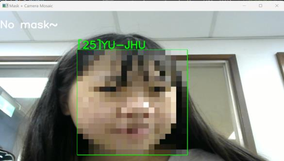

- **語言**：Python
- **影像處理**：OpenCV(Haar Cascade人臉偵測、LBPH人臉辨識)
- **深度學習**：TensorFlow/Keras(口罩偵測模型，以Google Teachable Machine訓練)

## 功能

| 程式 | 功能 |
|---|---|
| [`1_face_mosaic.py`](1_face_mosaic.py) | 鏡頭即時人臉偵測，畫面中所有人臉自動打上馬賽克 |
| [`train_face_model.py`](train_face_model.py) | 讀取每個人的照片，擷取臉部區域，以LBPH演算法訓練人臉辨識模型並存成`face.yml` |
| [`2_camera_face_recognition_mosaic.py`](2_camera_face_recognition_mosaic.py) | 鏡頭即時人臉辨識，在人臉旁標示姓名(無法辨識者顯示`???`)，只對**指定人物**打馬賽克，可用按鍵切換 |
| [`3_mask_detection.py`](3_mask_detection.py) | 鏡頭即時偵測是否配戴口罩 |
| [`4_picture_face_recognition_mosaic.py`](4_picture_face_recognition_mosaic.py) | 對照片進行人臉辨識與馬賽克，依辨識結果按對應數字鍵切換該人物的馬賽克狀態 |
| [`5_combined.py`](5_combined.py) | 整合上述所有功能：口罩偵測、人臉辨識、自動馬賽克、按鍵切換 |

## 運作流程

1. **人臉偵測**：影像轉為灰階後，以OpenCV提供的Haar Cascade特徵模型(`haarcascade_frontalface_default.xml`)找出畫面中的人臉區域。
2. **馬賽克處理**：把人臉區域縮小為原本的1/15，再用最近鄰插值放大回原尺寸，產生方塊狀的馬賽克效果。
3. **人臉辨識**：以`cv2.face.LBPHFaceRecognizer`訓練每位成員的臉部特徵；辨識時回傳id與信心指數，信心指數小於65才視為辨識成功並顯示對應姓名，否則顯示`???`。
4. **口罩偵測**：擷取畫面中央區域並縮放為224×224，輸入以Teachable Machine訓練的Keras模型，分類為「沒戴口罩」「有戴口罩」「背景」三類。
5. **按鍵控制**：依辨識出的人物按下對應數字鍵，即可切換該人物的馬賽克狀態；按`q`結束程式。

| 人臉辨識模型訓練流程 | 口罩偵測模型訓練(Teachable Machine) |
|---|---|
| 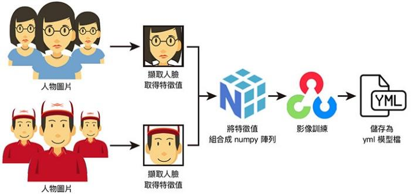 | 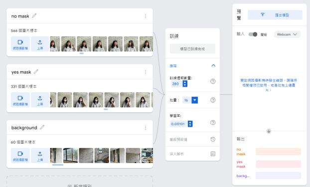 |

## 執行畫面

| 鏡頭即時人臉馬賽克 | 人臉辨識+指定人物馬賽克 |
|---|---|
| 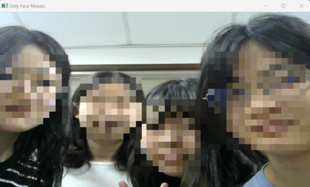 | 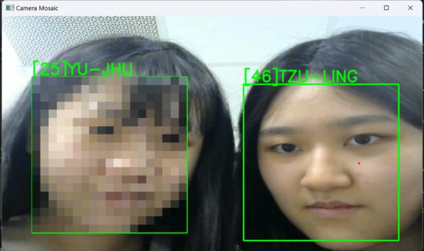 |

| 口罩偵測：有戴口罩 | 口罩偵測：沒戴口罩 |
|---|---|
| 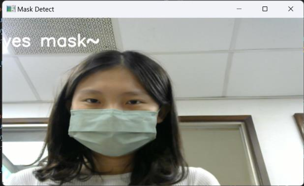 | 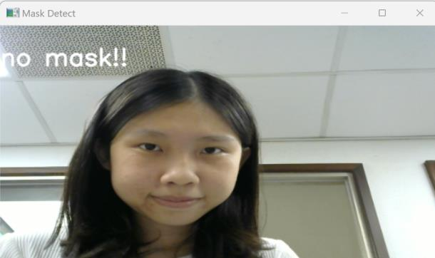 |

| 照片人臉辨識+馬賽克 | 按數字鍵切換後取消馬賽克 |
|---|---|
| 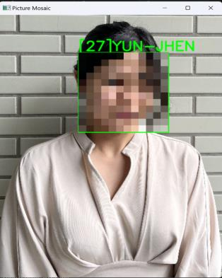 | 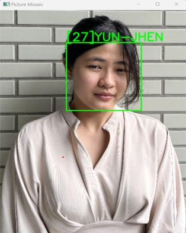 |

| 整合功能：偵測到戴口罩，提醒拿下 | 整合功能：按數字鍵取消馬賽克 |
|---|---|
| 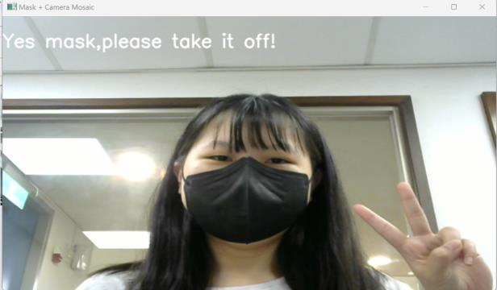 | 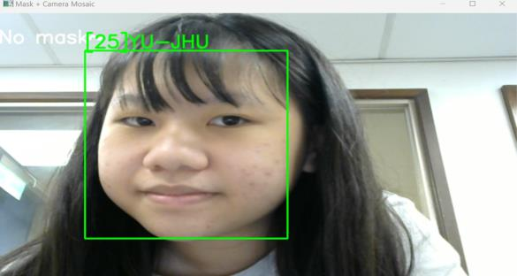 |

## 開發過程中的調整

- **照片素材**：一開始使用網路上的人物照片，但修圖、濾鏡與濃妝會降低辨識率，最後改用成員本人在不同地點、角度與光線下拍攝的照片，從近千張中篩選出可用的素材。
- **背景干擾**：磚牆等複雜背景容易被誤判為多張人臉，因此篩除這類照片。
- **辨識偏差**：曾發生其他人被大量誤判為同一位成員的情況，透過調整各成員照片數量的比例改善。
- **信心指數門檻**：經多次實驗後，將門檻設為65，在辨識成功率與誤判之間取得平衡。

## 專案結構

```
Face-Detection-Mosaic/
├── train_face_model.py                    訓練人臉辨識模型(產生face.yml)
├── 1_face_mosaic.py                       鏡頭人臉馬賽克
├── 2_camera_face_recognition_mosaic.py    鏡頭人臉辨識+指定人物馬賽克
├── 3_mask_detection.py                    口罩偵測
├── 4_picture_face_recognition_mosaic.py   照片人臉辨識+按鍵切換馬賽克
├── 5_combined.py                          整合所有功能
├── haarcascade_frontalface_default.xml    OpenCV人臉特徵模型
├── keras_model.h5                         口罩偵測模型
├── labels.txt                             口罩偵測分類標籤
├── requirements.txt
└── docs/images/                           流程圖與執行畫面
```

## 安裝與執行

1. 安裝套件(人臉辨識需要`opencv-contrib-python`才有`cv2.face`模組)：

   ```bash
   pip install -r requirements.txt
   ```

2. 只需要鏡頭的功能可以直接執行：

   ```bash
   python 1_face_mosaic.py      # 人臉馬賽克
   python 3_mask_detection.py   # 口罩偵測
   ```

3. 人臉辨識相關功能需要先訓練自己的模型：
   - 建立`face01/`、`face02/`…資料夾，每個資料夾放一個人的照片，依序命名為`1.jpg`、`2.jpg`…
   - 依照片數量調整`train_face_model.py`裡的迴圈範圍，以及程式中id與姓名的對照表
   - 執行`python train_face_model.py`，完成後會產生`face.yml`
   - 再執行`2_camera_face_recognition_mosaic.py`、`4_picture_face_recognition_mosaic.py`或`5_combined.py`

4. 所有視窗都按`q`結束。

## 說明

- 人臉辨識模型`face.yml`與訓練用的成員照片屬於個人臉部資料，且模型檔超過300MB，因此沒有收錄在此repo中，請依上方步驟用自己的照片重新訓練。
- `haarcascade_frontalface_default.xml`來自[OpenCV官方提供的特徵模型](https://github.com/opencv/opencv/tree/4.x/data/haarcascades)；口罩偵測模型以[Teachable Machine](https://teachablemachine.withgoogle.com/)訓練後匯出。

## 開發分工

本專題為4人團隊開發，我負責的部分：

- **提出專題主題**，並找到參考程式碼作為開發基礎
- **主導整體功能的概念與實作**，負責程式整合、執行與除錯(專題主要在我的電腦上完成開發與測試)
- 與組員共同進行功能修改、照片蒐集與模型訓練
- 擔任主要報告者，負責功能介紹、開發困難說明，以及全部功能的Demo
